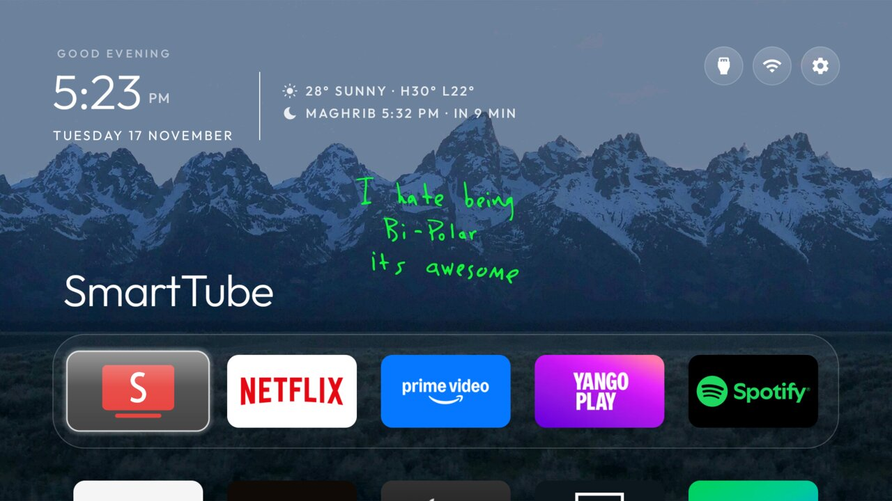

# Glass header: a fork of cleanyourtv

This branch keeps all of [cleanyourtv](https://github.com/Gathin23/cleanyourtv) and changes the launcher's top bar
and header. It is not reviewed by the upstream project; read this page and the diff before you install it.



## What it adds

- **Gear and Wi-Fi dropdowns.** The gear and the network pill open glass dropdowns like Inputs does. The gear has TV
  system settings, Display, Network, Apps and Launcher settings (holding OK still opens the existing menu). The
  network one shows the Wi-Fi network or Ethernet with its status, the Private DNS host when one is active, a
  speed test and More settings. These change what the two buttons do on every TV, with no switch.
- **Speed test.** A row in the network dropdown. Press OK to measure download and upload against
  `speed.cloudflare.com` (4 connections each way, about 16 s), shown live in the row. It runs only when pressed.
- **Weather beside the clock** (`clock_line`). The Weather add-on publishes today's reading as one line with an
  icon ("28° Sunny · H30° L22°"); the launcher only reads it.
- **Next prayer beside the clock** (`game_day` with `game_day_compact`). The Prayer Times add-on publishes the next
  prayer through the existing `game_day` contract; `game_day_compact` shows it as one line ("Maghrib 5:32 PM · in
  43 min") instead of the panel under the clock.
- **Header layout** (`header_widgets_beside`, `header_offset_dp`). The date goes under the time, the weather and
  prayer lines beside them after the divider, and the block can sit lower.
- **Settings button highlight.** With `settings_key_panel`, the remote's Settings button also lights the gear behind
  the panel.
- **Wallpaper at boot.** Home keeps a copy of `wallpaper.jpg` for the seconds before storage is mounted
  (upstream PR [#4105](https://github.com/Gathin23/cleanyourtv/pull/4105)).

## Theme keys

All are off unless a theme's `config.json` sets them:

```json
{
  "clock_line": "io.github.sumyabazar1.weather",
  "game_day": "com.majnioui.tv.prayer",
  "game_day_compact": true,
  "header_widgets_beside": true,
  "header_offset_dp": 24
}
```

## Network and permissions

Unlike upstream, this launcher has the `INTERNET` permission. Only the speed test uses it, and only when its row is
pressed; nothing else in the launcher goes online. The Weather add-on (Open-Meteo) and the Prayer Times add-on
(Aladhan) fetch their own data as before; their new read-only providers fetch only when the launcher reads them and
the last reading is old. Nothing is collected or sent anywhere else. No analytics, no accounts.

## Build and install

Exactly as upstream: `TV_HOST=<tv ip> INPUT_KEY_SERVICE=1 HOME_KEY_SERVICE=1 launcher/build-and-install.sh`, then
build and install the two add-ons from `addons/weather` and `addons/prayer-times` as their READMEs say, set the
Prayer Times city in its `config.xml`, and push a theme with the keys above (`tools/theme.sh`).

The launcher APK is about 600 KB, above upstream's 576 KB size gate, so this branch cannot be merged upstream as is.

## Tested on

Xiaomi MiTV-MZTU0 (Xiaomi TV A Pro 43 2026), Google TV 14, with the physical remote.

Issues: <https://github.com/Momad-Y/cleanyourtv/issues>. Licence: MIT, as upstream.
